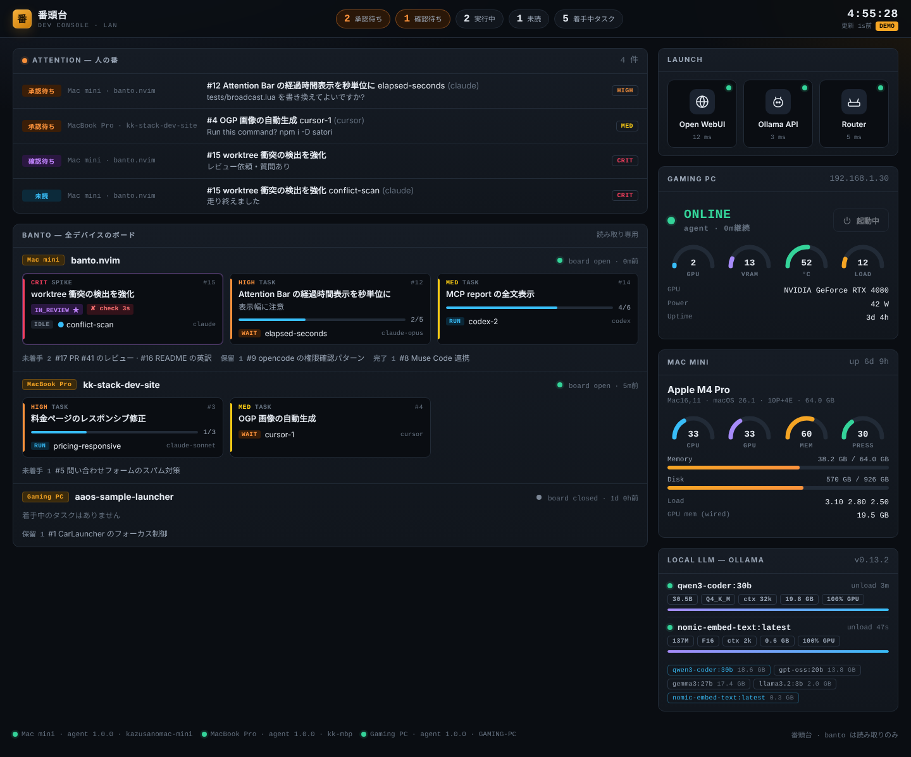
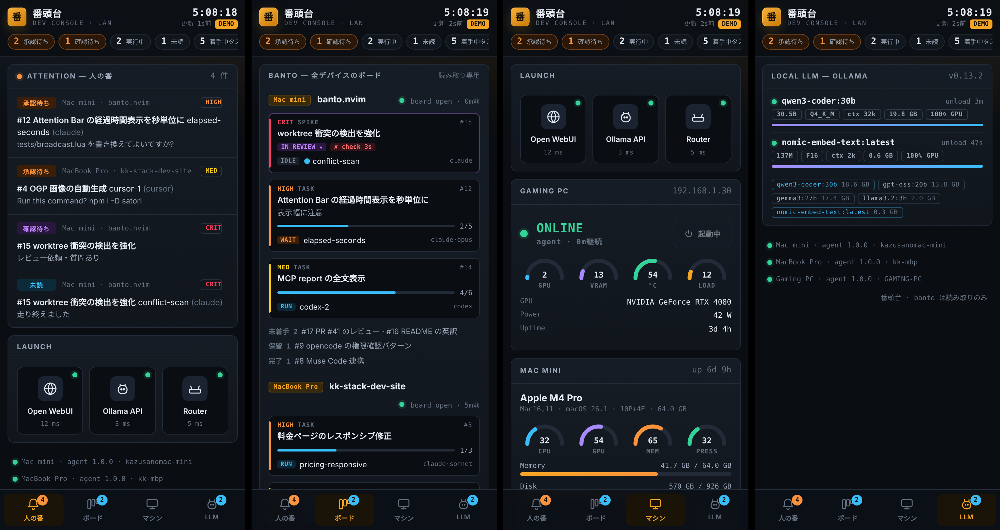

# 番頭台 (dev-dashboard)

LAN 内専用の開発ダッシュボードです。1 画面で次のものを見られます。

- **Attention**: 全デバイスの banto で、承認待ち・確認待ち (IN_REVIEW)・未読のセッションを優先度順に並べます
- **banto ボード**: デバイスごと・リポジトリごとに、着手中のカードを表示します。未着手・保留・完了は件数とタイトルだけを出します
- **Launch**: Open WebUI などのリンクと、それぞれの死活・応答時間
- **Gaming PC**: オンラインかどうか、Wake-on-LAN ボタン、GPU 使用率・VRAM・温度 (agent を入れた場合)
- **Mac mini**: チップ、CPU・GPU・メモリ使用率、メモリプレッシャー、ディスク、熱による制限
- **Ollama**: ロード中のモデル (VRAM の量、アンロードまでの残り時間、コンテキスト長) とインストール済みのモデル



スマホでは下のタブ (AI承認待ち / タスクボード / マシン / LLM) で切り替えます。Safari の「ホーム画面に追加」でアプリのように開けます。



agent は依存パッケージなしで、Python 3.9 以降の標準ライブラリだけで動きます。hub も同じですが、スマホへの通知を使うときだけ `pywebpush` が要ります ([スマホに通知を送る](#スマホに通知を送る))。

## 構成

```
[MacBook] agent.py :8765 ─┐
[Gaming PC] agent.py :8765 ┼─► [Mac mini] hub.py :8080 ─► ブラウザ (LAN 内)
[Mac mini] (hub が直接読む) ┘        ├ Ollama :11434
                                    └ Open WebUI の死活確認
```

- `agent.py`: 各デバイスで動かします。banto.nvim の保存ファイル (`~/.local/share/nvim/banto/*.json`) を**読むだけ**です。GET 以外のリクエストには 405 を返します
- `hub.py`: Mac mini で動かします。各デバイスの agent から情報を集め、画面を配信します
- どちらも、プライベート IP 以外からのアクセスには 403 を返します

## まず画面だけ見る

```sh
python3 hub.py --demo
# → http://localhost:8080
```

## 設定 — IP は書かなくてよい

各デバイスの agent が 10 秒ごとに LAN へブロードキャスト (UDP 8766) で名乗り、hub がそれを受けて IP と MAC アドレスを覚えます。IP が DHCP で変わっても追従します。覚えた内容は `known_devices.json` に保存するので、ゲーミング PC の電源が切れていても WoL を送れます。

**Mac mini (hub)**

```sh
python3 hub.py        # config.json は無くても動く
```

スマホへの通知も使うときは、venv に `pywebpush` を入れてその Python で起動します。

```sh
uv venv .venv && VIRTUAL_ENV=.venv uv pip install -r requirements-hub.txt   # uv が無ければ python3 -m venv .venv && .venv/bin/pip install -r requirements-hub.txt
.venv/bin/python hub.py
```

Open WebUI (`:3000`) と Ollama API (`:11434`) のリンクは最初から入っています。リンクの `{host}` は、ブラウザで開いているダッシュボードのホスト名に置き換わるので、IP を書く必要はありません。変えたい項目だけ `config.json` に書きます (`config.example.json` を参照)。

ログイン時に自動で起動するには `launchd/dev.kkstack.dashboard.hub.plist` の `__DIR__` を置き換えて `~/Library/LaunchAgents/` に置き、`launchctl load` します。この plist は `.venv/bin/python` で起動するので、先に上の venv を作っておきます。

**MacBook など**

```sh
python3 agent.py --name "MacBook Pro"
```

常駐させるには `launchd/dev.kkstack.dashboard.agent.plist` を使います。

**Gaming PC (Windows)**

```bat
pythonw agent.py --name "Gaming PC" --role gaming
```

- `--role gaming` を付けた agent が Gaming PC 欄に入り、WoL の対象になります
- **最初の 1 回だけ**、PC を起動した状態で agent を動かしてください。そのとき hub が ARP テーブルから実際に通信した NIC の MAC アドレスを覚えます
- タスクスケジューラの「ログオン時」に登録して常駐させます。Windows ファイアウォールの許可を求められたら「プライベートネットワーク」だけを許可します
- `nvidia-smi` があれば GPU の情報も返します。無い場合 (AMD・Intel など) は、Windows の DXGI とパフォーマンスカウンターから GPU 使用率と VRAM を返します。温度と消費電力は取れないので「—」になります。WSL の中で banto を使っている場合は、WSL の中でも agent を動かしてください (役割なしで)

**自動検出が届かないとき**

Wi-Fi のクライアント分離や別セグメントなどでブロードキャストが届かない場合は、`config.json` の `devices` に `.local` のホスト名で書けます。この場合も IP は要りません。

| キー | 内容 |
| --- | --- |
| `local_name` | Mac mini 自身の表示名 |
| `devices` | 手で足すデバイス。`{"id", "name", "agent": "http://<host>.local:8765"}` |
| `gaming_pc` | 自動検出した値に上書きで重ねます。`{"mac": "34:5A:60:EA:E8:D2"}` だけ書けば、IP は自動のまま MAC を固定でき、agent を一度も起動していなくても WoL を送れます。`host` / `broadcast` / `name` も書けます |
| `discovery.enabled` | `false` で自動検出を止めます |
| `links[].icon` | `openwebui` / `ollama` / `router`。`favicon` に URL を書いてアイコンを指定することもできます |

## agent のオプション

```sh
python3 agent.py --once       # 収集結果を 1 回だけ表示して確認する
BANTO_DATA_DIR=... python3 agent.py   # banto の persist.dir を変えている場合
python3 agent.py --no-beacon  # 自動検出用のブロードキャストを止める
```

## Wake-on-LAN

- ボタンは誤操作を防ぐため 2 回押しで送ります (1 回目で「もう一度押して送信」に変わり、4 秒で元に戻ります)
- 送信後、最大 3 分は `WAKING…` と表示します
- 他のサイトから勝手に送られないよう、`/api/wol` は独自ヘッダー `X-Dashboard: 1` が無いリクエストを拒否します
- ゲーミング PC 側では、BIOS/UEFI の WoL と、NIC の詳細設定の「Magic Packet で起動」を有効にしておきます

## スマホに通知を送る

ホーム画面に追加した番頭台へ、Web Push で通知を送ります。通知する出来事は次のとおりです。

| 出来事 | `notify.events` のキー |
| --- | --- |
| AI の処理が終わった・失敗した (セッションが RUN/WAIT から IDLE/DONE/FAIL に変わった) | `ai_done` |
| 承認待ち (WAIT) になった・タスクが確認待ち (IN_REVIEW) になった | `attention` |
| Gaming PC が起動した | `gaming_up` |
| Launch のリンクが 2 回続けて応答しなかった・戻った | `link` |
| Mac mini のメモリプレッシャーが 85% 以上・熱で CPU が制限された (30 分に 1 回まで) | `mac_load` |

ボードを開いていないプロジェクトは数えません (nvim を閉じただけで「終わった」と鳴らさないため)。一度に 5 件以上起きたときは 1 件にまとめます。

**1. hub に pywebpush を入れる** — 上の「Mac mini (hub)」の venv の手順です。初回起動時に VAPID 鍵 `vapid_private.pem` ができます。購読先は `push_subscriptions.json` に保存します (どちらも git には入りません。鍵を作り直すと、スマホ側でオンにし直す必要があります)。

**2. HTTPS で開けるようにする** — iPhone は `http://` のページに通知を許可しません。Tailscale を使うのがいちばん簡単です。

1. Tailscale の管理画面の DNS で MagicDNS と「HTTPS Certificates」を有効にします
2. Mac mini で次を実行します (Mac App Store 版は `/Applications/Tailscale.app/Contents/MacOS/Tailscale` を `tailscale` の代わりに使います)

   ```sh
   tailscale serve --bg 8080
   ```

3. iPhone に Tailscale アプリを入れて同じアカウントでログインし、表示された `https://<Mac mini の名前>.<tailnet>.ts.net/` を Safari で開きます

`tailscale serve` は 127.0.0.1 から hub に中継するので、hub の LAN 限定のチェックはそのまま通ります。tailnet の外からは見えません。

**3. iPhone で通知をオンにする** — Safari の共有ボタンから「ホーム画面に追加」し (iOS 16.4 以降)、ホーム画面のアイコンから開きます。右上のベルを押して「通知をオンにする」を押し、許可します。テスト通知が届けば完了です。通知を押すと、関係するタブが開きます。

設定は `config.json` の `notify` で変えられます。

```json
"notify": {
  "events": {"mac_load": false},
  "mem_pressure": 90,
  "contact": "mailto:you@example.com"
}
```

`contact` は Push サービス (Apple など) に伝える連絡先です。`mailto:` か、パスの無い `https://ホスト名` だけが使えます。

## banto の状態について

- banto はタスクが変わるたびに約 0.3 秒後に JSON へ保存します。ダッシュボードは 5 秒ごとに読むので、ほぼリアルタイムに追従します
- ボードが閉じているとき (ロックファイルの PID が生きていないとき) は、保存されている `running` / `waiting` を `IDLE` として表示します
- 承認待ちの質問文そのものは保存されないため、Attention には最後のレビュー依頼・質問 (`last_request`) を出します。無ければ「許可を求めています」と表示します
- アーカイブ (`*.archive.json`) は読みません

## API

| パス | 内容 |
| --- | --- |
| `GET hub:/api/state` | 画面が使う全データ |
| `POST hub:/api/wol` | WoL を送る (ヘッダー `X-Dashboard: 1` が必須) |
| `GET agent:/api/snapshot` | そのデバイスの banto とシステムの情報 |
| `GET agent:/api/health` | 死活確認 |
| `UDP 8766` (ブロードキャスト) | agent が名乗る。中身は名前・役割・待ち受けポート・MAC だけ |
